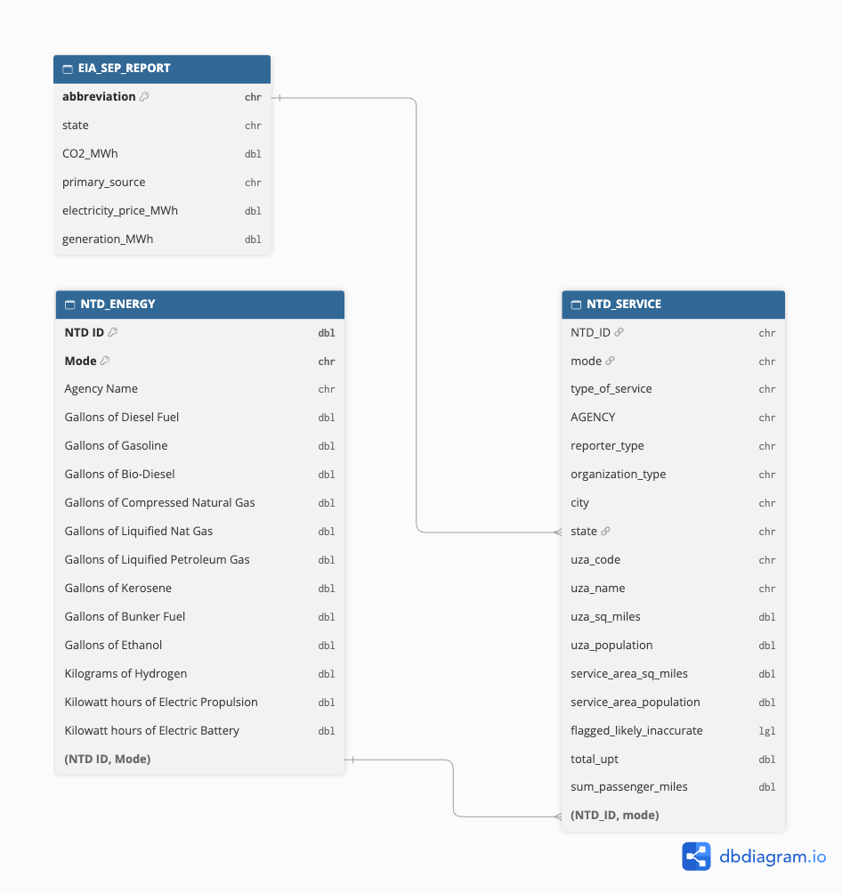

```{=html}
<style>
body {
  background: url("bg.png") center / cover no-repeat fixed !important;
}
#quarto-document-content {
  background: rgba(255, 255, 255, 0.92);
  border-radius: 16px;
  padding: 2rem 2.5rem;
  box-shadow: 0 8px 30px rgba(0, 0, 0, 0.15);
}
</style>
```

## Introduction

The project is intended to find out the annual winners of GTA awards for the “greenest” public transit agencies. The project is done by Fayzullo Inatilloev, Executive Director of the Green Transit Alliance (GTA). NTD transit energy and service data and EIA state electricity data were used to conduct this project. The agencies were compared based on CO2 emissions on per passenger-mile.

## Data Acquisition and Preparation

### Task 1a: State electricity profiles

```{r}
#| message: false
#| warning: false
library(tidyverse)
library(stringr)
library(httr2)
library(rvest)

get_eia_sep <- function(state, abbr){
    library(tidyverse)
    library(stringr)
    library(httr2)
    library(rvest)
    library(fs)
  
    state_formatted <- str_to_lower(state) |> str_replace_all("\\s", "")
    
    dir_name <- fs::path("data", "mp02")
    file_name <- fs::path(dir_name, state_formatted)
    
    fs::dir_create(dir_name, recurse=TRUE)
    
    if(!fs::file_exists(file_name)){
        BASE_URL <- "https://www.eia.gov"
        RESPONSE <- request(BASE_URL) |> 
          req_url_path("electricity", 
                       "state", 
                       state_formatted) |>
          req_headers(
            `User-Agent` = "Mozilla/5.0 (Macintosh; Intel Mac OS X 10.15; rv:149.0) Gecko/20100101 Firefox/149.0"
            ) |>   
          req_retry(
                max_tries = 4, 
          ) |>
          req_perform(file_name)
    
        resp_check_status(RESPONSE)
    }
    
    TABLE <- read_html(file_name) |> 
        html_element("table") |> 
        html_table() |>
        mutate(Item = str_to_lower(Item))
    
    if("U.S. rank" %in% colnames(TABLE)){
        TABLE <- TABLE |> rename(Rank = `U.S. rank`)
    }
    
    CO2_MWh <- TABLE |> 
        filter(Item == "carbon dioxide (lbs/mwh)") |>
        pull(Value) |> 
        str_replace_all(",", "") |>
        as.numeric()
    
    PRIMARY <- TABLE |> 
        filter(Item == "primary energy source") |> 
        pull(Rank)
    
    RATE <- TABLE |>
        filter(Item == "average retail price (cents/kwh)") |>
        pull(Value) |>
        as.numeric()
    
    GENERATION_MWh <- TABLE |>
        filter(Item == "net generation (megawatthours)") |>
        pull(Value) |>
        str_replace_all(",", "") |>
        as.numeric()
    
    data.frame(CO2_MWh               = CO2_MWh, 
               primary_source        = PRIMARY,
               electricity_price_MWh = RATE * 10, # / 100 cents to dollars &
               # * 1000 kWh to MWH 
               generation_MWh        = GENERATION_MWh, 
               state                 = state, 
               abbreviation          = abbr
    )
}

EIA_SEP_REPORT <- map2(state.name, state.abb, get_eia_sep) |> list_rbind()
```


### Task 1b: NTD energy use

```{r}
#| warning: false
load_ntd_energy <- function(){
  library(readxl)
  library(httr2)
  library(tidyverse)
  library(fs)
  
  # Create 'data/mp02' directory if not already present
  DATA_DIR <- fs::path("data", "mp02")
  fs::dir_create(DATA_DIR, recurse=TRUE)

  NTD_ENERGY_FILE <- fs::path(DATA_DIR, "2025_ntd_energy.xlsx")

  if(!fs::file_exists(NTD_ENERGY_FILE)){
    library(httr2)
  
    request("https://www.transit.dot.gov/") |>
      req_url_path("sites",
                   "fta.dot.gov",
                   "files",
                   "2026-09",
                   "2025 Energy Consumption_260806.xlsx") |> 
      req_headers(
        `User-Agent` = "Mozilla/5.0 (Macintosh; Intel Mac OS X 10.15; rv:149.0) Gecko/20100101 Firefox/149.0") |> 
      req_perform(NTD_ENERGY_FILE)
  }
  
  if(file.info(NTD_ENERGY_FILE)$size < 1e4){
        cat("I was unable to download the NTD Energy File. Please try again.\n")
        stop("Download failed. Please delete the corrupted file by running `unlink('data/mp02/2025_ntd_energy.xlsx')` and try again.")
    }

  to_numeric_fill_0 <- function(x){
    x <- if_else(x == "-", NA, x)
    replace_na(as.numeric(x), 0)
  }

  read_excel(NTD_ENERGY_FILE) |> 
    select(-c(`Reporter Type`, 
              `Reporting Module`, 
              `Gallons of Other Fuel`, 
              `Other Fuel Description`)) |>
    mutate(across(-c(`Agency Name`, 
                     `Mode`,
                     `TOS`), 
                  to_numeric_fill_0)) |>
    group_by(`NTD ID`, `Mode`, `Agency Name`) |>
    summarize(across(where(is.numeric), sum), 
              .groups = "keep") |>
    mutate(ENERGY = sum(c_across(c(where(is.numeric))))) |>
    filter(ENERGY > 0) |>
    select(-ENERGY) |>
    ungroup()
}

NTD_ENERGY <- load_ntd_energy()
```


### Task 1c: NTD service

```{r}
#| warning: false
load_ntd_service <- function(){
  library(httr2)
  library(tidyverse)
  library(fs)
  
  # Create 'data/mp02' directory if not already present
  DATA_DIR <- fs::path("data", "mp02")
  fs::dir_create(DATA_DIR, recurse=TRUE)

  NTD_SERVICE_FILE <- fs::path(DATA_DIR, "2025_ntd_service.csv")

  if(!fs::file_exists(NTD_SERVICE_FILE)){
    library(httr2)
  
    request("https://data.transportation.gov/resource/4fir-qbim.csv") |>
      req_url_query(`$query`=paste(
        "SELECT  `_5_digit_ntd_id` AS `NTD_ID`", 
        "`max_agency` AS `AGENCY`",
        "`max_reporter_type` AS `reporter_type`",
        "`max_organization_type` AS `organization_type`",
        "`max_city` AS `city`",
        "`max_state` AS `state`",
        "`mode`",
        "`type_of_service`",
        "`max_primary_uza_code` as `uza_code`",
        "`max_primary_uza_name` as `uza_name`",
        "`max_primary_uza_area_sq_miles` as `uza_sq_miles`",
        "`max_primary_uza_population` as `uza_population`",
        "`max_service_area_sq_miles` as `service_area_sq_miles`",
        "`max_service_area_population` as `service_area_population`",
        "`questionable_record` as `flagged_likely_inaccurate`",
        "`sum_unlinked_passenger_trips_upt` as `total_upt`",
        "`sum_passenger_miles` WHERE caseless_one_of(`report_year`, '2025') limit 50000", 
        sep=",")) |>
      req_headers(
        `User-Agent` = "Mozilla/5.0 (Macintosh; Intel Mac OS X 10.15; rv:149.0) Gecko/20100101 Firefox/149.0") |> 
      req_perform(NTD_SERVICE_FILE)
  }
  
  if(file.info(NTD_SERVICE_FILE)$size < 1e4){
        cat("I was unable to download the NTD Service File. Please try again.\n")
        stop("Download failed. Please delete the corrupted file by running `unlink('data/mp02/2025_ntd_service.xlsx')` and try again.")
    }

  read_csv(NTD_SERVICE_FILE) |>
    mutate(flagged_likely_inaccurate = !is.na(flagged_likely_inaccurate))
}

NTD_SERVICE <- load_ntd_service()
```
```{r}
# NTD_ENERGY |> distinct(Mode) |> arrange(Mode)
# NTD_SERVICE |> distinct(mode) |> arrange(mode)
```

```{r}
# Translate NTD 2-letter mode codes into readable names
# (definitions from the NTD Glossary)
recode_mode <- function(x){
  recode_values(x,
    "AR" ~ "Alaska Railroad",
    "CB" ~ "Commuter Bus",
    "CC" ~ "Cable Car",
    "CR" ~ "Commuter Rail",
    "DR" ~ "Demand Response",
    "FB" ~ "Ferryboat",
    "HR" ~ "Heavy Rail",
    "IP" ~ "Inclined Plane",
    "LR" ~ "Light Rail",
    "MB" ~ "Bus",
    "MG" ~ "Monorail/Automated Guideway",
    "RB" ~ "Bus Rapid Transit",
    "SR" ~ "Streetcar Rail",
    "TB" ~ "Trolleybus",
    "TR" ~ "Aerial Tramway",
    "VP" ~ "Vanpool",
    "YR" ~ "Hybrid Rail",
    default = "Unknown")
}

NTD_ENERGY  <- NTD_ENERGY  |> mutate(Mode = recode_mode(Mode))
NTD_SERVICE <- NTD_SERVICE |> mutate(mode = recode_mode(mode))
```

### Extra Credit: Data Relationship Diagram

This diagram describes the relationship between three tables used in the project: NTD_ENERGY ↔ NTD_SERVICE on agency ID + mode (a two-column key), NTD_SERVICE ↔ EIA_SEP_REPORT on state.



## Exploratory Analysis

### 3a.1: Which 5 states have the most expensive retail electricity?

```{r}
EIA_SEP_REPORT |>
  slice_max(electricity_price_MWh, n = 5) |>
  ggplot(aes(x = reorder(state, electricity_price_MWh),
             y = electricity_price_MWh)) +
  geom_col(fill = "steelblue", width = 0.5) +
  geom_text(aes(label = scales::dollar(electricity_price_MWh, accuracy = 1)),
            hjust = -0.15, size = 5) +
  coord_flip() +
  scale_y_continuous(labels = scales::dollar,
                     expand = expansion(mult = c(0, 0.15))) +
  labs(x = NULL,
       y = "Average retail price ($ per MWh)",
       title = "MOST EXPENSIVE ELECTRICITY STATES",
       subtitle = "This chart shows the price people pay per MWh",
       caption = "Source: EIA State Electricity Profiles") +
  theme_minimal(base_size = 14) +
  theme(panel.grid.major.y = element_blank(),
        plot.title = element_text(face = "bold"))
price_of <- function(st){
  EIA_SEP_REPORT |>
    filter(state == st) |>
    pull(electricity_price_MWh) |>
    scales::dollar(accuracy = 1)
}
```

**Answer:**   
The research results have shown that top states where cost of electricity is the most expensive are Hawaii (`r price_of("Hawaii")`), California (`r price_of("California")`), Connecticut (`r price_of("Connecticut")`), Rhode Island (`r price_of("Rhode Island")`), Massachusetts (`r price_of("Massachusetts")`). People in Hawaii pay considerably more than in other states.


### 3a.2: Which 5 states have the “dirtiest” electricity mix?

```{r}
library(gt)
EIA_SEP_REPORT |>
  slice_max(CO2_MWh, n = 5) |>
  select(state, primary_source, CO2_MWh) |>
  gt() |>
  tab_header(
    title = md("**5 DIRTIEST ELECTRICITY STATES**"),
    subtitle = "Table shows how dirty each unit of electricity is") |>
  cols_label(state = "State",
             primary_source = "Primary Energy Source",
             CO2_MWh = "CO₂ Emitted (lbs per MWh)") |>
  fmt_number(columns = CO2_MWh, decimals = 0) |>
  data_color(columns = CO2_MWh,
             method = "numeric",
             palette = c("#FDBB84", "#B30000")) |>
  cols_align(align = "center", columns = c(primary_source, CO2_MWh)) |>
  tab_style(style = cell_text(weight = "bold"),
            locations = cells_column_labels()) |>
  tab_source_note("Source: EIA State Electricity Profiles") |>
  opt_stylize(style = 6, color = "gray")
co2_of <- function(st){
  EIA_SEP_REPORT |>
    filter(state == st) |>
    pull(CO2_MWh) |>
    scales::comma(accuracy = 1)
}
```

**Answer:**   
The research results have shown that top states where CO₂ per MWh is emitted the most are West Virginia (`r co2_of("West Virginia")` lbs), Kentucky (`r co2_of("Kentucky")` lbs) , Wyoming (`r co2_of("Wyoming")` lbs),  Missouri (`r co2_of("Missouri")` lbs), Hawaii (`r co2_of("Hawaii")` lbs). 


### 3a.3: On average, how many pounds of CO₂ are emitted per MWh in the US? (weighted average)

```{r}
us_avg_co2 <- EIA_SEP_REPORT |>
  summarize(avg = weighted.mean(CO2_MWh, w = generation_MWh)) |>
  pull(avg)
```

**Answer:**   
`r scales::comma(us_avg_co2, accuracy = 1)` pounds of CO₂ are emitted per MWh on average in the US.


### 3a.4: What are the 3 rarest primary energy sources? What's the electricity cost for each, and in which states are they used?

```{r}
EIA_SEP_REPORT |>
  group_by(primary_source) |>
  summarize(n_states  = n(),
            avg_price = mean(electricity_price_MWh),
            states    = paste(state, collapse = ", ")) |>
  slice_min(n_states, n = 3) |>
  arrange(n_states, desc(avg_price)) |>
  gt() |>
  tab_header(
    title = md("**THE 3 RAREST PRIMARY ENERGY SOURCES**"),
    subtitle = "Table shows the rarest primary energy sources used in the USA") |>
  cols_label(primary_source = "Primary Energy Source",
             n_states       = "Number of States",
             avg_price      = "Average Price (per MWh)",
             states         = "States") |>
  fmt_currency(columns = avg_price, decimals = 0) |>
  data_color(columns = avg_price,
             method = "numeric",
             palette = c("#C7E9C0", "#E6550D")) |>
  cols_width(primary_source ~ px(170),
             n_states       ~ px(110),
             avg_price      ~ px(140),
             states         ~ px(320)) |>
  cols_align(align = "center", columns = c(n_states, avg_price)) |>
  tab_style(style = cell_text(weight = "bold"),
            locations = list(cells_column_labels(),
                             cells_body(columns = primary_source))) |>
  tab_footnote(footnote = "Simple average of the retail prices in the listed states.",
               locations = cells_column_labels(columns = avg_price)) |>
  tab_source_note("Source: EIA State Electricity Profiles") |>
  opt_stylize(style = 6, color = "gray")
```

**Answer:**   
The list of rarest primary energy sources includes: petroleum, hydroelectric, wind energies. Petroleum is the most expensive primary energy source (average price of petroleum is $380), which is nearly 3.4 times more than the average prices of the other two sources. Also, it is worth mentioning that petroleum is used by Hawaii state only.


### 3a.5: How many times cleaner is NY’s energy mix than Texas’s?

```{r}
ny_co2 <- EIA_SEP_REPORT |> filter(abbreviation == "NY") |> pull(CO2_MWh)
tx_co2 <- EIA_SEP_REPORT |> filter(abbreviation == "TX") |> pull(CO2_MWh)
ny_vs_tx <- tx_co2 / ny_co2
```

**Answer:**   
NY’s energy mix is `r round(ny_vs_tx, 1)` times cleaner than Texas’s.


### 3b.2: Visualizing the amounts of each type of fuel used across all US public transit.

```{r}
FUEL_TOTALS <- NTD_ENERGY |>
  # Ethanol column duplicates Hydrogen exactly for all 16 agencies (data error) - dropped
  select(-`Gallons of Ethanol`) |>
  pivot_longer(-c(`NTD ID`, Mode, `Agency Name`),
               names_to = "fuel",
               values_to = "amount") |>
  group_by(fuel) |>
  summarize(total = sum(amount)) |>
  mutate(unit = case_when(str_detect(fuel, "^Gallons")   ~ "gallons",
                          str_detect(fuel, "^Kilograms") ~ "kg",
                          TRUE                           ~ "kWh"),
         fuel = str_remove(fuel, "^(Gallons|Kilograms|Kilowatt hours) of "))

short_num <- scales::label_number(scale_cut = scales::cut_short_scale(),
                                  accuracy = 0.1)

UNIT_COLORS <- c(gallons = "steelblue", kWh = "#E6A819", kg = "#5AAE61")

plot_fuel <- function(which_unit, axis_label, title_text, subtitle_text){
  FUEL_TOTALS |>
    filter(unit == which_unit, total > 0) |>
    ggplot(aes(x = total, y = reorder(fuel, total))) +
    geom_col(fill = UNIT_COLORS[which_unit], width = 0.6) +
    geom_text(aes(label = short_num(total)), hjust = -0.1, size = 4.5) +
    scale_x_continuous(labels = scales::label_number(scale_cut = scales::cut_short_scale()),
                       expand = expansion(mult = c(0, 0.2))) +
    labs(x = axis_label, y = NULL,
         title = title_text, subtitle = subtitle_text,
         caption = "Source: National Transit Database, 2025 Energy Consumption") +
    theme_minimal(base_size = 14) +
    theme(panel.grid.major.y = element_blank(),
          plot.title = element_text(face = "bold", hjust = 0.5),
          plot.subtitle = element_text(hjust = 0.5),
          plot.title.position = "plot",
          plot.margin = margin(10, 25, 10, 10))
}

p_gallons <- plot_fuel("gallons", "Total gallons used per year",
                       "TOTAL LIQUID & GAS USED PER YEAR",
                       "This graph shows liquid & gas used across all US public transit per year")

p_kwh <- plot_fuel("kWh", "Total kWh used per year",
                   "TOTAL ELECTRICITY USED PER YEAR",
                   "This graph shows electricity used across all US public transit per year")

p_kg <- plot_fuel("kg", "Total kg used per year",
                  "TOTAL HYDROGEN USED PER YEAR",
                  "This graph shows hydrogen used across all US public transit per year")

# Energy content per unit (lower heating value, BTU)
ENERGY_BTU <- c("Diesel Fuel"             = 128488,  # per gallon
                "Gasoline"                = 116090,  # per gallon
                "Bio-Diesel"              = 119550,  # per gallon
                "Compressed Natural Gas"  = 116090,  # per gasoline-gallon equivalent (assumed)
                "Liquified Petroleum Gas" = 84250,   # per gallon (propane)
                "Liquified Nat Gas"       = 74720,   # per gallon
                "Electric Propulsion"     = 3414,    # per kWh
                "Electric Battery"        = 3414,    # per kWh
                "Hydrogen"                = 113725)  # per kg

p_all <- FUEL_TOTALS |>
  filter(total > 0, fuel %in% names(ENERGY_BTU)) |>
  mutate(btu   = total * ENERGY_BTU[fuel],
         label = paste(short_num(total), unit)) |>
  ggplot(aes(x = btu, y = reorder(fuel, btu), fill = unit)) +
  geom_col(width = 0.6) +
  geom_text(aes(label = label), hjust = -0.1, size = 4.5) +
  scale_x_continuous(labels = scales::label_number(scale = 1e-12),
                     expand = expansion(mult = c(0, 0.4))) +
  scale_fill_manual(values = UNIT_COLORS, name = "Measured in") +
  labs(x = "Energy content (trillion BTU)", y = NULL,
       title = "TOTAL FUELS USED PER YEAR",
       subtitle = "This graph shows all fuels used across all US public transit per year.\nBar length is linked to BTU measurement to understand the energy worth.\nThe numbers on the bars are the actual amounts used",
       caption = "Source: National Transit Database, 2025 Energy Consumption;\nenergy factors: US DOE Alternative Fuels Data Center") +
  theme_minimal(base_size = 14) +
  theme(panel.grid.major.y = element_blank(),
        legend.position = "bottom",
        plot.title = element_text(face = "bold", hjust = 0.5),
        plot.subtitle = element_text(hjust = 0.5),
        plot.title.position = "plot",
        plot.margin = margin(10, 25, 10, 10))
```

::: {.panel-tabset}

#### Liquid & gas fuels (gallons)

```{r}
#| echo: false
p_gallons
```

#### Electricity (kWh)

```{r}
#| echo: false
p_kwh
```

#### Hydrogen (kg)

```{r}
#| echo: false
p_kg
```

#### All fuels (energy, BTU)

```{r}
#| echo: false
p_all
```

:::


**Answer:**   
The graphs show amounts of each type of fuel used across all US public transit. Graphs are divided into measurement types (gallons, kWh, kg) and unified into one chart under one unit - BTU ([info.](https://en.wikipedia.org/wiki/British_thermal_unit)). It is worth mentioning that out of the list, most energy being consumed per year is diesel fuel with usage of 437.9M gallons. 


### 3c.1: Which five transit services have the most UPT annually? (graph)

```{r}
NTD_SERVICE |>
  group_by(AGENCY, mode) |>
  summarize(upt = sum(total_upt, na.rm = TRUE), .groups = "drop") |>
  slice_max(upt, n = 5) |>
  mutate(service = str_wrap(paste0(AGENCY, " (", mode, ")"), width = 30)) |>
  ggplot(aes(x = upt, y = reorder(service, upt))) +
  geom_col(fill = "steelblue", width = 0.6) +
  geom_text(aes(label = short_num(upt)), hjust = -0.1, size = 4.5) +
  scale_x_continuous(labels = scales::label_number(scale_cut = scales::cut_short_scale()),
                     expand = expansion(mult = c(0, 0.2))) +
  labs(x = "Unlinked passenger trips (UPT) per year",
       y = NULL,
       title = "TOP 5 BUSIEST TRANSIT SERVICES BY UPT PER YEAR",
       subtitle = "The chart counts how many times passengers board a transit vehicle in a year ",
       caption = "Source: National Transit Database, 2025 Service by Agency") +
  theme_minimal(base_size = 14) +
  theme(panel.grid.major.y = element_blank(),
        plot.title = element_text(face = "bold", hjust = 0.5),
        plot.subtitle = element_text(hjust = 0.5),
        plot.title.position = "plot",
        plot.margin = margin(10, 25, 10, 10))
```

**Answer:**   
The chart above shows top 5 transit services that have the most UPT annually. The list includes: MTA New York City Transit (Heavy Rail), MTA New York City Transit (Bus), Los Angeles County Metropolitan Transportation Authority, Chicago Transit Authority, Washington Metropolitan Area Transit Authority.


### 3c.2: What is the average trip length of a trip on MTA NYC?

```{r}
mta_trip_length <- NTD_SERVICE |>
  filter(AGENCY == "MTA New York City Transit") |>
  summarize(avg_trip = sum(sum_passenger_miles, na.rm = TRUE) /
                       sum(total_upt, na.rm = TRUE)) |>
  pull(avg_trip)
```

**Answer:**
Average trip length of a trip on MTA NYC is `r round(mta_trip_length, 1)` miles.


## Total Emissions per Agency and Mode

```{r}
# Step 1: one row per agency + mode (the service table splits some services into directly-operated and purchased-transportation rows)
SERVICE_BY_MODE <- NTD_SERVICE |>
  mutate(NTD_ID = as.numeric(NTD_ID)) |>
  group_by(NTD_ID, mode) |>
  summarize(agency          = first(AGENCY),
            state           = first(state),
            upt             = sum(total_upt, na.rm = TRUE),
            passenger_miles = sum(sum_passenger_miles, na.rm = TRUE),
            .groups = "drop")

# Step 2: joining fuel use + service + state electricity mix
EMISSIONS <- NTD_ENERGY |>
  select(-`Gallons of Ethanol`) |>                  # duplicate of Hydrogen (see 3b.2)
  inner_join(SERVICE_BY_MODE,
             join_by(`NTD ID` == NTD_ID, Mode == mode)) |>
  inner_join(EIA_SEP_REPORT |> select(abbreviation, CO2_MWh),
             join_by(state == abbreviation)) |>
  # Step 3: total CO2 (lbs) = fuel used x CO2 per unit, summed over all fuels
  # Factors: EIA CO2 emissions coefficients (lbs CO2 per gallon)
  mutate(co2_lbs =
           `Gallons of Diesel Fuel`             * 22.45 +
           `Gallons of Bio-Diesel`              * 22.45 +   # assumed same as diesel
           `Gallons of Gasoline`                * 18.73 +
           `Gallons of Liquified Petroleum Gas` * 12.68 +   # propane
           `Gallons of Kerosene`                * 21.78 +
           `Gallons of Bunker Fuel`             * 24.78 +   # residual fuel oil
           `Gallons of Compressed Natural Gas`  * 13.54 +   # natural gas, per gasoline-gallon equivalent
           `Gallons of Liquified Nat Gas`       * 8.72  +   # natural gas, per LNG gallon
           `Kilograms of Hydrogen`              * 0     +   # no tailpipe CO2
           (`Kilowatt hours of Electric Propulsion` +
            `Kilowatt hours of Electric Battery`) * CO2_MWh / 1000)  # state grid, lbs/MWh -> lbs/kWh
```

### Top 10 emitters table
```{r}
EMISSIONS |>
  slice_max(co2_lbs, n = 10) |>
  select(agency, Mode, state, CO2_MWh, co2_lbs) |>
  mutate(co2_lbs = co2_lbs / 1e6) |>
  gt() |>
  tab_header(
    title = md("**TOP 10 EMITTERS TABLE**"),
    subtitle = "The table shows 10 largest emitters by total CO2, each row is Agency + Mode") |>
  cols_label(agency  = "Agency",
             Mode    = "Mode",
             state   = "State",
             CO2_MWh = "State grid CO₂ (lbs per MWh)",
             co2_lbs = "Total CO₂ (million lbs per year)") |>
  fmt_number(columns = CO2_MWh, decimals = 0) |>
  fmt_number(columns = co2_lbs, decimals = 1) |>
  data_color(columns = co2_lbs,
             method = "numeric",
             palette = c("#FDBB84", "#B30000")) |>
  cols_align(align = "center", columns = c(Mode, state, CO2_MWh, co2_lbs)) |>
  tab_style(style = cell_text(weight = "bold"),
            locations = cells_column_labels()) |>
  tab_source_note("Sources: National Transit Database (2025); EIA State Electricity Profiles; EIA CO₂ emission coefficients") |>
  opt_stylize(style = 6, color = "gray")
```


## Emissions per Trip and per Passenger-Mile

```{r}
AGENCY_EMISSIONS <- EMISSIONS |>
  # Combining all modes of each agency (e.g., MTA bus + subway)
  group_by(`NTD ID`, agency, state) |>
  summarize(co2_lbs         = sum(co2_lbs),
            upt             = sum(upt),
            passenger_miles = sum(passenger_miles),
            n_modes         = n(),
            .groups = "drop") |>
  # Dropping very small agencies (unreliable ratios) and rows with no mileage
  filter(upt >= 100000, passenger_miles > 0) |>
  mutate(co2_per_upt  = co2_lbs / upt,
         co2_per_mile = co2_lbs / passenger_miles,
         size = case_when(upt < 5e6  ~ "Small",
                          upt < 50e6 ~ "Medium",
                          TRUE       ~ "Large"),
         size = factor(size, levels = c("Small", "Medium", "Large")))

# Top 3 greenest agencies (lowest CO2 per passenger-mile) in each size group
AGENCY_EMISSIONS |>
  add_count(size, name = "n_in_group") |>
  mutate(group_label = paste0(size, " agencies (", n_in_group, " in group)")) |>
  group_by(size) |>
  slice_min(co2_per_mile, n = 3) |>
  ungroup() |>
  mutate(agency = str_remove(agency, "^.*dba: ")) |>   # keep the short public name
  select(group_label, agency, state, upt, co2_per_upt, co2_per_mile) |>
  gt(groupname_col = "group_label") |>
  tab_header(
    title = md("**TOP 3 GREENEST AGENCIES**"),
    subtitle = "The table shows top 3 greenest agencies (lowest CO₂ per passenger-mile) in each size group")|>
  cols_label(agency       = "Agency",
             state        = "State",
             upt          = "Trips per year (UPT)",
             co2_per_upt  = "CO₂ per trip (lbs)",
             co2_per_mile = "CO₂ per passenger-mile (lbs)") |>
  fmt_number(columns = upt, suffixing = TRUE, decimals = 1) |>
  fmt_number(columns = co2_per_upt, decimals = 2) |>
  fmt_number(columns = co2_per_mile, decimals = 3) |>
  data_color(columns = co2_per_mile,
             method = "numeric",
             palette = c("#2CA25F", "#E5F5E0")) |>
  cols_align(align = "center", columns = c(state, upt, co2_per_upt, co2_per_mile)) |>
  tab_style(style = cell_text(weight = "bold"),
            locations = list(cells_column_labels(), cells_row_groups())) |>
  tab_source_note("Size groups are by trips per year: Small = under 5M, Medium = 5M–50M, Large = 50M+.") |>
  opt_stylize(style = 6, color = "gray")
```
**Answer:**
Here are some insights of the findings. Agencies that showed results under 100K trips were excluded out of the research. The greenest agencies in size are Seattle Center Monorail (small), Anaheim Regional Transportation (medium), TriMet (Large). It is easy to catch that most of greenest agencies belong to WA, CA, OR, and NY. 

## Awards


### Award 1: Clean in Dirty Country

```{r}
# States whose grid is dirtier than the US weighted average (from 3a.3)
DIRTY_GRID <- EIA_SEP_REPORT |>
  filter(CO2_MWh > us_avg_co2) |>
  select(abbreviation, CO2_MWh, primary_source)

# Agencies operating in those states
DIRTY_GRID_AGENCIES <- AGENCY_EMISSIONS |>
  inner_join(DIRTY_GRID, join_by(state == abbreviation))

# Top 3 cleanest agencies in dirty-grid states, by size group,
# with the group median as a reference value
DIRTY_GRID_AGENCIES |>
  group_by(size) |>
  mutate(group_median = median(co2_per_mile),
         group_label  = paste0(size, " agencies (median: ",
                               round(group_median, 3), " lbs per passenger-mile)")) |>
  slice_min(co2_per_mile, n = 3) |>
  ungroup() |>
  mutate(agency = str_remove(agency, "^.*dba: ")) |>
  select(group_label, agency, state, primary_source, CO2_MWh, co2_per_mile) |>
  gt(groupname_col = "group_label") |>
  tab_header(
    title = md("**CLEAN IN DIRTY COUNTRY**"),
    subtitle = "Winners for the award are shown in each category") |>
  cols_label(agency         = "Agency",
             state          = "State",
             primary_source = "State's main power source",
             CO2_MWh        = "State grid CO₂ (lbs per MWh)",
             co2_per_mile   = "CO₂ per passenger-mile (lbs)") |>
  fmt_number(columns = CO2_MWh, decimals = 0) |>
  fmt_number(columns = co2_per_mile, decimals = 3) |>
  data_color(columns = co2_per_mile,
             method = "numeric",
             palette = c("#2CA25F", "#E5F5E0")) |>
  cols_align(align = "center",
             columns = c(state, primary_source, CO2_MWh, co2_per_mile)) |>
  tab_style(style = cell_text(weight = "bold"),
            locations = list(cells_column_labels(), cells_row_groups())) |>
  tab_source_note("Dirty grid = state grid emits more CO₂ per MWh than the US weighted average (785 lbs). Sources: NTD 2025; EIA.") |>
  opt_stylize(style = 6, color = "gray")
```

```{r}
#| warning: false
#| fig-height: 7
#| fig-width: 10
library(ggrepel)

# Winner (cleanest agency) in each size group on a dirty grid
DIRTY_WINNERS <- DIRTY_GRID_AGENCIES |>
  group_by(size) |>
  slice_min(co2_per_mile, n = 1) |>
  ungroup() |>
  mutate(label = paste0(str_remove(agency, "^.*dba: "), " (", size, ")"))

p_dirty <- AGENCY_EMISSIONS |>
  inner_join(EIA_SEP_REPORT |> select(abbreviation, CO2_MWh),
             join_by(state == abbreviation)) |>
  ggplot(aes(x = CO2_MWh, y = co2_per_mile)) +
  annotate("rect", xmin = us_avg_co2, xmax = Inf, ymin = 0, ymax = Inf,
           fill = "grey85", alpha = 0.5) +
  annotate("text", x = Inf, y = Inf, label = "Dirtier-than-average grid",
           hjust = 1.05, vjust = 1.5, size = 4.5, fontface = "bold", color = "grey40") +
  geom_vline(xintercept = us_avg_co2, linetype = "dashed", color = "grey40") +
  geom_point(color = "grey60", alpha = 0.6, size = 2) +
  geom_point(data = DIRTY_WINNERS, color = "#2CA25F", size = 4.5) +
  geom_label_repel(data = DIRTY_WINNERS, aes(label = label),
                   color = "#2CA25F", fontface = "bold", size = 4,
                   box.padding = 0.8, min.segment.length = 0) +
  scale_y_log10(labels = scales::label_number(accuracy = 0.01)) +
  labs(x = "State electricity grid: lbs of CO2 per MWh",
       y = "Agency: lbs of CO2 per passenger-mile (log scale)",
       title = "Clean in Dirty Country",
       subtitle = "Green dots = award winners,\nGrey area = states with dirtier-than-average electricity,\nLower = less CO2 per passenger-mile",
       caption = "Each dot is one transit agency. Dashed line: US weighted-average grid.\nSources: National Transit Database (2025); EIA State Electricity Profiles; EIA CO2 coefficients.") +
  theme_minimal(base_size = 14) +
  theme(panel.grid.minor = element_blank(),
        plot.title = element_text(face = "bold", hjust = 0.5),
        plot.subtitle = element_text(hjust = 0),
        plot.title.position = "plot",
        plot.margin = margin(10, 25, 10, 10))
```

**Winners:**

- The winner of small agencies category is **Denver Regional Council of Governments**
- The winner of medium agencies category is **Worcester Regional Transit Authority**
- The winner of large agencies category is **Massachusetts Bay Transportation Authority**


### Award 2: Ferry Tale Award

```{r}
#| fig-height: 9
#| fig-width: 10
FERRIES <- EMISSIONS |>
  filter(Mode == "Ferryboat", upt >= 100000, passenger_miles > 0) |>
  mutate(co2_per_mile = co2_lbs / passenger_miles,
         agency = str_remove(agency, "^.*dba: "))

# Reference: a solo driver in a car averaging 25 mpg (assumption);
# EIA: 18.73 lbs of CO2 per gallon of finished motor gasoline
CAR_CO2_PER_MILE <- 18.73 / 25

# Key numbers for the write-up
FERRY_SUMMARY <- FERRIES |>
  summarize(n_ferries    = n(),
            winner       = agency[which.min(co2_per_mile)],
            winner_value = min(co2_per_mile),
            median_value = median(co2_per_mile),
            n_beat_car   = sum(co2_per_mile < CAR_CO2_PER_MILE))

p_ferry <- FERRIES |>
  mutate(label = paste0(agency, " (", state, ")"),
         label = fct_reorder(label, co2_per_mile, .desc = TRUE),
         group = if_else(co2_per_mile == min(co2_per_mile),
                         "Award winner", "Other ferry services")) |>
  ggplot(aes(x = co2_per_mile, y = label, color = group)) +
  geom_segment(aes(x = 0.3, xend = co2_per_mile, yend = label), linewidth = 1) +
  geom_point(size = 3.5) +
    geom_text(data = \(d) filter(d, group != "Award winner"),
            aes(label = scales::number(co2_per_mile, accuracy = 0.01)),
            hjust = -0.4, size = 4, show.legend = FALSE) +
  geom_text(data = \(d) filter(d, group == "Award winner"),
            aes(label = scales::number(co2_per_mile, accuracy = 0.01)),
            vjust = -1.1, size = 4.5, fontface = "bold", show.legend = FALSE) +
  scale_y_discrete(expand = expansion(add = c(0.6, 1.2))) +
  geom_vline(xintercept = CAR_CO2_PER_MILE, linetype = "dashed",
             color = "#D95F02", linewidth = 0.8) +
  annotate("text", x = CAR_CO2_PER_MILE, y = 3, label = "Solo driver\nin a car",
           hjust = 1.1, color = "#D95F02", size = 4.5, fontface = "bold") +
  scale_x_log10(breaks = c(0.5, 1, 2, 5, 10, 20),
                labels = c("0.5", "1", "2", "5", "10", "20"),
                limits = c(0.3, 45)) +
  scale_color_manual(values = c("Award winner" = "#2CA25F",
                                "Other ferry services" = "grey55"),
                     name = NULL) +
  labs(x = "lbs of CO2 per passenger-mile (log scale)", y = NULL,
       title = "Ferry Tale Award",
       subtitle = "The award is given to an agency that emits the least CO2 per passenger-mile",
       caption = "Sources: National Transit Database (2025); EIA CO2 coefficients.\nCar reference: one driver, 25 mpg, 18.73 lbs CO2 per gallon of gasoline.") +
  theme_minimal(base_size = 14) +
  theme(panel.grid.major.y = element_blank(),
        panel.grid.minor = element_blank(),
        legend.position = "bottom",
        plot.title = element_text(face = "bold", hjust = 0.5),
        plot.subtitle = element_text(hjust = 0.5),
        plot.title.position = "plot",
        plot.margin = margin(10, 25, 10, 10))
```
**Winner:**   
The winner of Ferry Tale Award is **Chicago Water Taxi (Wendella), IL** with 0.50 lbs of CO₂ per passenger-mile

## Press Release

### Winners of annual Green Transit Alliance awards are out!

*New York City, November 6, 2026*: Green Transit Alliance (non-profit organization) announced its annual awards results. After thorough measurements conducted among hotly-debated modes of transport, the GTA decided on what awards will be presented this year. This year's awards are **"Clean in Dirty Country"** and **"Ferry Tale"**. Awards honor agencies that keep their CO2 emissions low. Data from EIA State Electricity Profiles, National Transit Database (NTD), and EIA Carbon Dioxide Emissions Coefficients were applied to calculate measurements.


#### Award 1: Clean in Dirty Country

The award honors the transit agencies that go clean, even though they work in states with high-emission power grids.

To find out the winners for this award, the GTA looked at all states whose electricity is dirtier than the US average (785 lbs of CO2 per MWh); 23 states qualified. Pollution is measured per passenger-mile. Tailpipe fuel emissions and power-plant emissions for electric vehicles were calculated to find the winners, where agencies with lowest CO2 emissions win. To make it fair, one winner is selected from each size group: small (under 5M trips a year), medium (5M–50M) and large (50M+).

The winner of small group size is **Denver Regional Council of Governments** with 0.164 lbs per passenger-mile among other agencies in the same size group with median value of 1.261. This is 7.7 times cleaner. The winner in medium group size is **Worcester Regional Transit Authority** with 0.592 lbs per passenger-mile among other agencies in the same size group with median value of 0.905. This is about 1.5 times cleaner. Finally, the winner of large group size is **MBTA** with 0.543 lbs per passenger-mile among other agencies in the same size group with median value of 0.73. This is about 1.3 times cleaner.

```{r}
#| warning: false
#| echo: false
#| fig-height: 7
#| fig-width: 10
p_dirty
```

#### Award 2: Ferry Tale

The award honors the greenest ferry service in the USA.

The winner was chosen among agencies with 100K+ trips yearly and 23 services qualified. Measurements of CO2 per passenger-mile emissions were compared and the lowest value wins. 

The winner of **Ferry Tale** was **Chicago Water Taxi (Wendella), IL** with the value of 0.50 lbs per passenger-mile where the median measurement was 2.38 lbs, so the winner is about 4.8× cleaner. 

```{r}
#| echo: false
#| fig-height: 9
#| fig-width: 10
p_ferry
```

#### About the Green Transit Alliance
This research has been conducted by Green Transit Alliance (GTA). The research results and all the information provided belong to right holders. The research results have been released on November 6th, 2026 (earlier than GTA VI).



::: {.callout-note title="AI Usage Statement" collapse="true"}

The help Claude (Anthropic) was used to write the codes, brainstorm certain ideas check for grammatical accuracy and typos along the project. The charts were made by R code, the ERD by dbdiagram code. All of the analytical writing has been conducted by the author 
:::

------------------------------------------------------------------------

This work ©2026 by inafzl was initially prepared as a Mini-Project for
STA 9750 at Baruch College. More details about this course can be found at
[the course site](https://michael-weylandt.com/STA9750) and instructions for
this assignment can be found at 
[MP #02](https://michael-weylandt.com/STA9750/mini/mini02.html)
